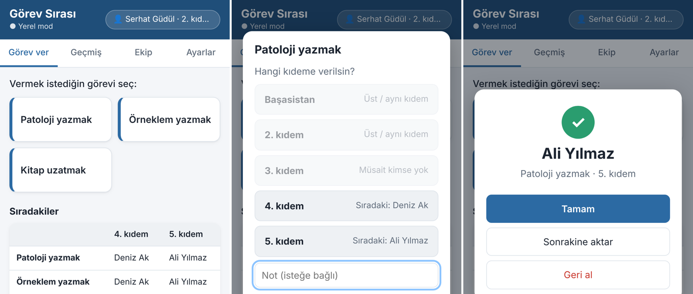

# Görev Sırası

Asistanlar arasında kıdeme göre, **sırayla ve adil** görev dağıtan bir web uygulaması.

Üst kıdem bir görev türüne (ör. *Patoloji yazmak*) dokunur, hangi kıdeme vereceğini seçer. Uygulama görevi o kıdemde **sırası gelen kişiye** atar. Başka biri aynı görevi aynı kıdeme verdiğinde görev bir sonraki kişiye gider. Sıra herkes için ortaktır ve Firebase üzerinden anında güncellenir.



## Nasıl çalışır

- **Ayrı sıralar:** Her *görev türü + kıdem* çiftinin kendi sırası vardır. Örneğin 5. kıdemin patoloji sırası ile örneklem sırası birbirinden bağımsızdır.
- **Görev yalnızca aşağı verilir:** "Ben kimim?" bölümünden kendini seçersin. Uygulama yalnızca senin altındaki kıdemleri açar. Hocalar "Listede yokum" seçeneğiyle her kıdeme görev verebilir.
- **İzinli:** Ekip sekmesinde "İzin" işaretlenen kişi, işaret kaldırılana kadar bütün sıralarda atlanır.
- **Sonrakine aktar:** Görevi alan kişi müsait değilse görev sıradaki kişiye geçer. Sıra o kişiden devam eder.
- **Geri al:** Yanlışlıkla verilen görev iptal edilir. Bu sırada arada başka görev verilmediyse sıra yine aynı kişide kalır.
- **Geçmiş:** Kim, kime, ne zaman, hangi görevi verdi; tamamlandı veya iptal durumu.
- **Sıra düzeni:** Ekip sekmesindeki ↑ ↓ düğmeleriyle değiştirilir. Yeni eklenen kişi kendi kıdeminin sırasının sonuna girer.
- **Yeni dönem:** Ayarlar sekmesinde "Herkesi bir üst kıdeme geçir" (5. kıdem → 4. kıdem …). Başasistan ekipten çıkar.
- Görev türleri ve kıdem adları Ayarlar sekmesinden değiştirilebilir. Kıdemler en kıdemliden en yeniye doğru sıralanır.
- Aynı anda iki kişi görev verirse Firestore işlemi (transaction) sayesinde ikisi aynı kişiye düşmez.

## Görevlerim, teslim tarihi ve tarihli izin

- **Görevlerim** sekmesi: sana verilen açık görevler (son güne göre sıralı), verdiğin ve henüz bitmemiş görevler ve son tamamladıkların. Sekmedeki kırmızı sayı açık görev sayını gösterir.
- **Teslim tarihi:** Görev verirken isteğe bağlı "Son gün" seçilir (Bugün / Yarın / 3 gün / 1 hafta ya da takvimden). Son günü geçen açık görevler kırmızı "Gecikti" etiketiyle görünür.
- **Tarihli izin:** Başasistan Ekip → ✎ → *Tarihli izin* bölümünden tarih aralığı ekler. Kişi o tarihlerde bütün sıralarda otomatik atlanır, izin bitince kendiliğinden sıraya döner. Ekip listesinde "İzinde" / "Planlı izin" olarak görünür.

## Tekrarlayan görevler

- Başasistan **Ayarlar → Tekrarlayan görevler** bölümünden tanımlar: görev, kıdem, sıklık (her gün / N günde, haftada veya ayda bir; isteğe bağlı *hafta sonları verme*), sıradaki tarih (son gün) ve kaç gün önce verileceği.
- Zamanı gelince görev o kıdemde sırası gelen kişiye **kendiliğinden** verilir (veren: 🔁 Otomatik), son gün olarak tekrar tarihi yazılır ve sonraki tarih ileri alınır. Ekipten giriş yapmış herhangi birinin uygulamayı açması yeterlidir; aynı tekrar için ikinci görev oluşmaz.
- **Dönüşümlü görev:** "Her N. seferde farklı görev" seçeneğiyle örneğin her ay *internetten uzatma*, her 3. ay *kütüphanede yüz yüze uzatma* verilir. Yüz yüze için ayrı görev türü seçilirse onun sırası da ayrı döner; kütüphaneye gitme işi ekipte adil dağılır.
- Görev ver sayfasında **Yaklaşan otomatik görevler** listesi, bir sonraki görevin ne olduğunu ve kime gideceğini gösterir.

## Duyuru panosu

- Görev ver sayfasının üstündeki **📢 Duyuru** kartından açılır. Giriş yapmış **herkes** duyuru yazabilir (en fazla 500 karakter, son 20 duyuru tutulur).
- Duyurulara yorum yazılmaz; yalnızca emojiyle tepki verilir.
- Okunmamış duyuru kartta **Yeni** etiketiyle görünür; pano açılınca okundu sayılır. **👁 9/13** düğmesi kimin okuduğunu ve kimin henüz okumadığını gösterir.
- Herkes kendi duyurusunu silebilir; başasistan tüm duyuruları silebilir.

## Kişisel profil kartı

- Ekip listesinde, Geçmiş'te veya ayın elemanı sıralamasında bir kişinin adına/fotoğrafına dokununca açılır.
- Bu ay aldığı ve tamamladığı görevler, tamamlama oranı, açık ve geciken görevleri, bu ay verdiği görevler, ayın elemanı kupaları, izin durumu ve son görevleri görünür.

## Emoji tepkileri

- Her görevin altındaki **☺︎+** ile 👍 🙏 ✅ 💪 👏 🔥 ❤️ 😂 😅 🤔 tepkilerinden biri verilir. Yazı girilemez; yalnızca bu listeden seçilir.
- Her kişinin bir görevde tek tepkisi olur; başka emojiye dokunmak değiştirir, aynı emojiye tekrar dokunmak kaldırır.
- Kimin hangi tepkiyi verdiği görevin altında yazar. İptal edilmiş görevlere tepki verilemez.

## Ayın elemanı

- "Tamamlandı" olarak işaretlenen her görev, görevi alan kişiye ve görevin **verildiği aya** sayılır. Ay sonunda en çok görev tamamlayan **ayın elemanı** olur; eşitlikte birden fazla kişi seçilir.
- Görev ver sayfasının üstünde geçen ayın elemanı (fotoğrafıyla) ve bu ayın ilk üçü görünür. Karta dokununca ay ay tam sıralama açılır.
- Geçen ayın elemanının adının yanında Ekip listesinde 🏆 görünür.
- "Geri aç" ya da tamamlanmış görevin iptali sayacı geri düşürür. Sayılar ekip verisinde ay ay saklanır; geçmiş listesi uzasa da kaybolmaz.

## Firebase kurulumu (ekipçe ortak kullanım, ~10 dakika, ücretsiz)

Firebase ayarlanmazsa uygulama **yerel mod**da çalışır: veriler yalnızca o cihazda kalır.

1. <https://console.firebase.google.com> adresinde **Proje ekle** deyin (Google Analytics gerekmez).
2. **Build → Authentication → Get started → Sign-in method** altında **Anonymous** (Anonim) yöntemini açın.
3. **Build → Firestore Database → Create database** ile bir veritabanı oluşturun (konum: `eur3` veya size yakın bir bölge, *production mode*).
4. Firestore'un **Rules** sekmesine bu depodaki `firestore.rules` dosyasının içeriğini yapıştırıp **Publish** deyin.
5. **Proje ayarları (⚙️) → Genel → Uygulamalarınız → Web (`</>`)** ile bir web uygulaması ekleyin. Size verilen `firebaseConfig` değerlerini `js/firebase-config.js` dosyasına yapıştırın.
6. **Authentication → Settings → Authorized domains** listesine GitHub Pages adresinizi ekleyin (ör. `kullaniciadi.github.io`).
7. Değişikliği GitHub'a gönderin. Başlıkta **● Ortak (canlı)** yazısını görüyorsanız bağlantı tamamdır.

> `firebaseConfig` değerleri gizli değildir; Firebase bunların sayfada görünmesini öngörür. Erişimi güvenlik kuralları belirler.

### Ekibi ilk kez yükleme

Ayarlar → **İçe aktar** ile ekip dosyasını (JSON) bir kez yükleyin. Firebase bağlıysa ekip herkese görünür. Ekip, Ekip sekmesinden elle de girilebilir.

## Giriş, PIN ve yetkiler

- Herkes adını seçip **PIN**'iyle giriş yapar. Giriş yapan kişi o cihazda sabittir; başka biri olarak işlem yapılamaz.
- **İlk kurulum:** Ekip yüklendikten sonra **başasistan** adını seçip kendine PIN belirler. Diğerlerinin PIN'lerini **Ekip** sekmesindeki 🔑 düğmesiyle o atar ve kişiye kendisi iletir.
- **Çıkış:** Üstteki isim düğmesi → **Çıkış yap** (ya da Ayarlar → Hesabım). Ortak bilgisayarlarda iş bitince çıkış yapın; tekrar girmek PIN gerektirir.
- Başasistan bir kişinin PIN'ini yeniden atarsa o kişinin açık oturumları kapanır. Her kullanıcı kendi PIN'ini **Ayarlar → Hesabım** bölümünden değiştirebilir.
- Yetkiler:
  - Görev verme: giriş yapan herkes, yalnızca alt kıdemlere.
  - Görev **iptali / geri alma**: yalnızca başasistan.
  - Sonrakine aktarma: görevi veren kişi veya başasistan.
  - Tamamlandı işareti: görevi alan, veren veya başasistan.
  - Ekip, izin, sıra, görev türleri, kıdemler, içe aktarma: yalnızca başasistan.
- Başasistan = **Kıdemler** listesinin en üstündeki kıdem. "Yeni dönem" ile kıdemler kayınca yeni başasistan bu yetkileri kendi PIN'iyle devralır.
- **Profil fotoğrafı:** Herkes kendi fotoğrafını üstteki isim düğmesinden (Hesabım) ekler; başasistan Ekip → ✎ ile herkesinkini değiştirebilir. Fotoğraflar 160×160 piksele küçültülüp ekip verisinde saklanır (Firebase Storage gerekmez).
- 5 yanlış PIN denemesinden sonra giriş 30 saniye kilitlenir.

> **Not:** PIN kontrolü tarayıcıda yapılır. Günlük kullanımda başkası adına işlem yapmayı engeller, ama tarayıcı geliştirici araçlarını bilen biri bu kontrolü aşabilir. Sunucu tarafında zorunlu kimlik doğrulaması gerekirse "Google ile giriş" eklenebilir.

## Güvenlik ve gizlilik

- Uygulama adresini bilen herkes görev verebilir ve listeyi görebilir. Adresi yalnızca ekiple paylaşın.
- **Not alanına hasta adı, TC kimlik no gibi kişisel sağlık verisi yazmayın (KVKK).** Not yerine protokol numarası gibi kurum içi bir kısaltma kullanın.
- Ekip isimlerini herkese açık bir GitHub deposuna koymak istemiyorsanız ekip dosyasını depoya eklemeyin; yalnızca içe aktarın.

## GitHub Pages'te yayınlama

1. Depoyu GitHub'a gönderin.
2. **Settings → Pages → Deploy from a branch → `main` / `(root)`** seçin.
3. Uygulama `https://<kullanıcı-adı>.github.io/<depo-adı>/` adresinde açılır. Telefonda tarayıcı menüsünden **Ana ekrana ekle** derseniz uygulama gibi açılır.

## Tema

- Varsayılan tema **sarı-lacivert**; **Ayarlar → Tema** bölümünden klasik maviye geçilebilir. Seçim her cihazda ayrı saklanır, koyu tema telefonun ayarına göre otomatik açılır.

## Telefona uygulama olarak ekleme

- **iPhone:** Safari'de siteyi aç → **Paylaş (□↑)** → **Ana Ekrana Ekle**.
- **Android:** Chrome'da siteyi aç → **⋮** → **Ana ekrana ekle / Uygulamayı yükle** (ya da uygulamadaki "Ana ekrana ekle" düğmesi).
- Uygulama simgesiyle, tam ekran açılır; güncellemeler otomatik gelir. iPhone'da ana ekrandan ilk açılışta PIN bir kez daha istenir.

## Yerelde çalıştırma ve testler

```bash
python3 -m http.server 8000   # http://localhost:8000
npm test                      # sıra mantığının birim testleri (Node 18+)
```

## Proje yapısı

```
index.html              Sayfa iskeleti
css/style.css           Stiller (mobil öncelikli, koyu tema)
js/rotation.js          Sıra mantığı (saf fonksiyonlar, testli)
js/backend.js           Veri katmanı: yerel (localStorage) veya Firebase Firestore
js/firebase-config.js   Firebase ayarları (boşsa yerel mod)
js/app.js               Arayüz
firestore.rules         Firestore güvenlik kuralları
tests/                  Birim testleri
```
